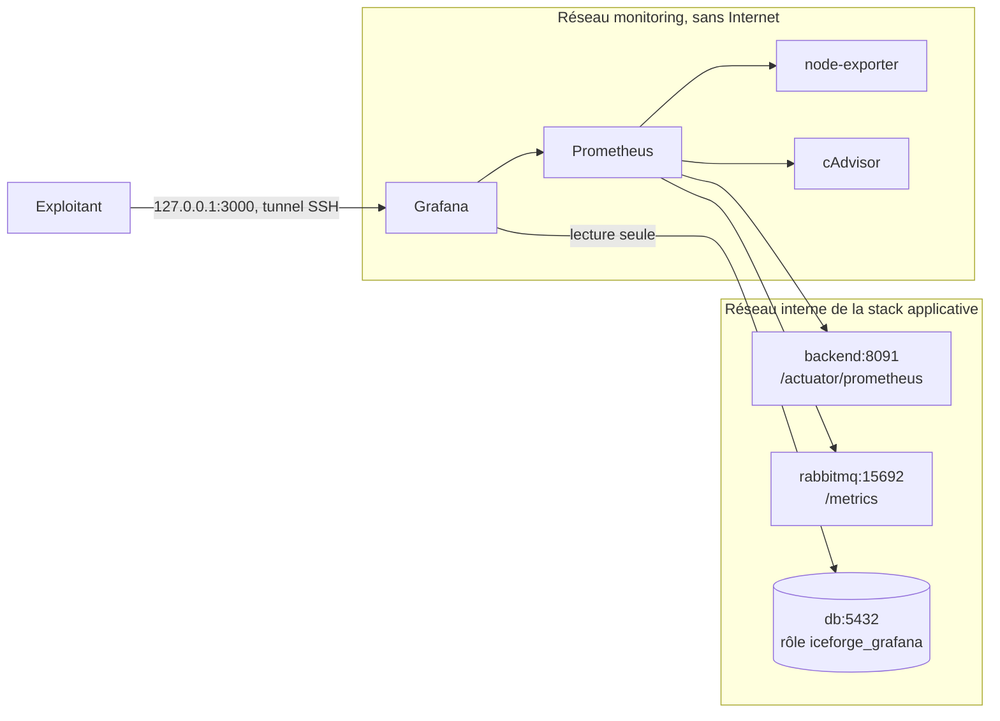

# Supervision et statistiques

Grafana affiche deux familles de tableaux de bord :

- **Métier** : ce qui se passe sur IceForge (utilisation du site, membres et leur activité, recrutement, flottes, événements, opérations, minage, contenu). Source : PostgreSQL en lecture seule, et les appels d'API comptés par Prometheus.
- **Technique** : l'état des serveurs (API, JVM, RabbitMQ, hôte, conteneurs). Source : Prometheus.

La stack tourne dans un projet Compose séparé de l'application : un déploiement applicatif ne la redémarre pas.



## Tableaux de bord

### Métier

| Tableau | Contenu |
|---|---|
| Utilisation du site (accueil) | appels par outil public (ressources de minage, achat de vaisseaux, Wikelo, guides, hangar exécutif…) et par fonctionnalité membre, modifications, connexions réussies et refusées, candidatures, actions venues de Discord, routes en erreur |
| Membres | membres en ligne, vus sur 7 et 30 jours, connexions par jour et par heure, inscriptions, rôles, préférences de notification |
| Activité des membres | filtre par membre : jours de connexion sur la période, connexions par jour, bilan (présences, affectations, fiches de minage, frais, ventes), journal daté de ce que le membre a fait, membres sans connexion. Réservé aux administrateurs Grafana |
| Recrutement | candidatures en attente et attente la plus longue, candidatures reçues, taux d'acceptation, gameplay recherché |
| Flottes et collections | vaisseaux déclarés, membres avec une flotte, achats en jeu et prêts, vaisseaux exécutifs, collections, vaisseaux et rôles les plus présents, plus grandes flottes |
| Événements | événements à venir et passés, réponses, présents par événement, membres les plus présents, types, publication Discord, événements Star Citizen |
| Opérations et objectifs | opérations publiées et brouillons, demandes de place et vaisseaux proposés, modèles d'équipage, objectifs et contributions |
| Minage | fiches, ventes, frais avancés (raffinage compris), bénéfice net ; raffinage prêt non remis ; minerais, terminaux, méthodes |
| Minage : partage et virements | virements en attente et montant restant, délai jusqu'à la clôture, frais avancés et remboursement par participant, bénéfice reçu par membre, réouvertures et clôtures forcées |
| Actualités et veille | actualités et guides publiés, veille CIG (collecte, traduction), envois Discord |
| Catalogue et données de jeu | synchronisations du catalogue, conflits à arbitrer, fraîcheur des données UEX, emplacements de minerai, Wikelo, images, IceLink |

Les tableaux s'affichent en listes « nom | valeur » avec une barre dans la cellule, lisibles même avec beaucoup de lignes. Un tableau retiré du générateur n'est pas effacé de Grafana au redémarrage : le supprimer avec `DELETE /api/dashboards/uid/<uid>`.

### Technique

| Tableau | Contenu |
|---|---|
| Vue d'ensemble | services joignables, files RabbitMQ sans lecteur, débit, erreurs et latence de l'API, ressources de l'hôte |
| Backend Spring | routes les plus appelées et les plus lentes, refus d'accès, JVM, pool PostgreSQL, messagerie, tâches planifiées, journaux |
| RabbitMQ | messages prêts et consommateurs par file, débits, lettres mortes, mémoire, disque, alarmes |
| Hôte et conteneurs | CPU, charge, mémoire, disques du serveur ; CPU, bridage, mémoire, réseau et disque par conteneur |

Chaque tableau donne accès aux autres par les menus « Tableaux métier » et « Tableaux techniques ».

## Exposition et données lues

- Le backend sert l'actuator sur un port de gestion distinct (`MANAGEMENT_PORT`, 8091 par défaut). Nginx ne relaie que le port 8080 : `/actuator` n'est jamais joignable depuis Internet. Sur ce port, seuls `/actuator/health` et `/actuator/prometheus` répondent sans jeton.
- Grafana lit PostgreSQL avec le rôle `iceforge_grafana` ([`postgres/grafana-reader.sql`](postgres/grafana-reader.sql)) : transactions en lecture seule, délai de 15 s par requête, 5 connexions au plus. Les droits portent sur des colonnes choisies : ni mots de passe, ni identifiants Discord, ni empreintes de jetons, ni clés de notification, ni textes des candidatures.
- Les tableaux métier affichent des pseudos de membres (présences, minage, virements). Grafana est donc réservé aux administrateurs.
- Prometheus, node-exporter et cAdvisor ne publient aucun port. Grafana n'écoute que sur `127.0.0.1`.

## Lancer en production

Le backend déployé doit contenir le port de gestion.

1. Créer `.secrets/monitoring.env` (non versionné), en `chmod 600` :

   ```bash
   GRAFANA_ADMIN_PASSWORD=<mot de passe long et unique>
   GRAFANA_DB_PASSWORD=<autre mot de passe long et unique>
   POSTGRES_DB=<nom de la base>
   ```

2. Créer le rôle de lecture (à rejouer après une migration qui recrée une table lue) :

   ```bash
   set -a; . .secrets/monitoring.env; set +a
   docker exec -i iceforge_db sh -c 'psql -X -v ON_ERROR_STOP=1 -U "$POSTGRES_USER" -d "$POSTGRES_DB" -v grafana_password="$1" -f -' -- "$GRAFANA_DB_PASSWORD" < ops/monitoring/postgres/grafana-reader.sql
   ```

   Le script s'arrête à la première colonne absente : un écart de schéma se voit tout de suite.

3. Démarrer :

   ```bash
   docker compose --env-file .secrets/monitoring.env -f ops/monitoring/docker-compose.monitoring.yml up -d
   ```

4. Ouvrir Grafana depuis le poste d'exploitation :

   ```bash
   ssh -N -L 3000:127.0.0.1:3000 <compte-ops>@<serveur>
   ```

   puis `http://127.0.0.1:3000`.

Le réseau supervisé par défaut est `iceforge_internal` (production). Prometheus garde 30 jours, plafonnés à 4 Go (`PROMETHEUS_RETENTION_TIME`, `PROMETHEUS_RETENTION_SIZE`). Les tableaux tirés de PostgreSQL couvrent tout l'historique de la base.

## Lancer contre la stack de dev

Les identifiants locaux sont dans `secrets/grafana-dev.env` (ignoré par git) : `GRAFANA_ADMIN_PASSWORD`, `GRAFANA_DB_PASSWORD`.

```powershell
$env:ICEFORGE_TARGET_NETWORK = 'iceforge_dev_internal'
$env:ICEFORGE_MONITORING_PROJECT = 'iceforge_dev_monitoring'
$env:GRAFANA_PORT = '13000'
docker compose --env-file secrets/grafana-dev.env -f ops/monitoring/docker-compose.monitoring.yml up -d
```

Grafana : `http://127.0.0.1:13000`. Créer le rôle avec la commande de l'étape 2, conteneur `iceforge_dev-db-1`. Arrêt : même commande Compose avec `down` (ajouter `-v` pour effacer l'historique).

## Modifier les tableaux

Ils sont provisionnés en lecture seule depuis `grafana/dashboards/metier/` et `grafana/dashboards/technique/`. Pour les modifier, éditer [`grafana/generate_dashboards.py`](grafana/generate_dashboards.py), puis :

```bash
python ops/monitoring/grafana/generate_dashboards.py
docker restart iceforge_monitoring-grafana-1
```

et committer le script et les JSON. Sous Docker Desktop, Grafana ne voit pas les fichiers modifiés sans redémarrage.

Les frais d'une fiche de minage suivent [la spécification V3](../../docs/mining-v3/SPEC.md) : frais saisis et coût des ordres de raffinage, remboursés à celui qui les a avancés. Dans les requêtes, `mining_fees` désigne cette somme.

Un panneau sans donnée affiche « Pas de donnée », jamais 0. Un 0 n'est affiché que s'il est mesuré.

## Limites connues

- **Pages vues :** elles ne sont pas comptées. « Utilisation du site » compte les appels d'API que chaque page déclenche. Pour compter les pages, il faudrait lire les journaux Nginx (Loki).
- **Premier appel non compté :** Prometheus ne compte pas le premier appel d'une route après un redémarrage du backend, car le compteur naît avec la valeur 1. Un 0 sur une route rarement utilisée peut cacher un appel isolé.
- **Historique d'usage :** il ne remonte pas au-delà de la rétention de Prometheus (30 jours).
- **Réponses aux événements :** la base ne les date pas. Elles sont rattachées à la date de l'événement, et « présent » est une intention, pas une présence vérifiée.
- **Membres vus récemment :** cette mesure repose sur `last_seen_at`, mis à jour à l'activité. Les membres connectés par jour viennent des jetons de session émis.
- **Bot Discord :** il ne garde aucune donnée et n'expose pas de métriques. Seuls ses appels à l'API sont visibles.
- **Réseau du serveur :** node-exporter tourne dans le réseau de supervision, donc le trafic réseau du serveur n'est pas mesuré. Celui de chaque conteneur l'est, via cAdvisor.
- **Conteneurs arrêtés :** cAdvisor ne voit que les conteneurs en marche.
- **Alertes :** il n'y a pas encore d'alertes Grafana. La sonde de [docs/PRODUCTION-MONITORING.md](../../docs/PRODUCTION-MONITORING.md) envoie les mails de panne.
