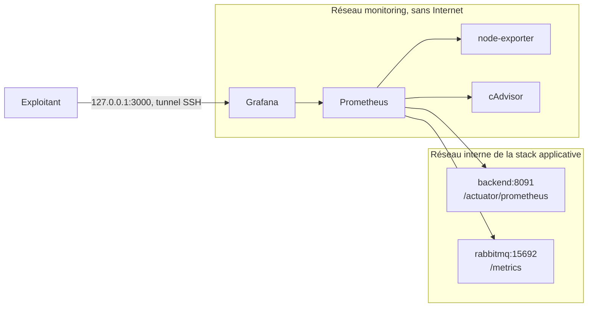

# Supervision technique

Prometheus collecte les métriques, Grafana les affiche. La stack tourne dans un projet Compose séparé de l'application : un déploiement applicatif ne la redémarre pas.



| Source | Contenu |
|---|---|
| Backend (`backend:8091`) | requêtes HTTP par route et statut, latences, JVM, pool Hikari, client RabbitMQ, tâches planifiées, journaux WARN/ERROR |
| RabbitMQ (`rabbitmq:15692`) | messages prêts et en cours par file, consommateurs, débits, lettres mortes, mémoire, disque, alarmes |
| node-exporter | CPU, charge, mémoire, disques et entrées-sorties du serveur |
| cAdvisor | CPU, bridage, mémoire, réseau et disque de chaque conteneur Compose |

## Exposition

- Le backend sert l'actuator sur un port de gestion distinct (`MANAGEMENT_PORT`, 8091 par défaut). Nginx ne relaie que le port 8080 : `/actuator` n'est jamais joignable depuis Internet.
- Sur ce port, seuls `/actuator/health` et `/actuator/prometheus` répondent sans jeton ; le reste est refusé (403). Sur le port 8080, `/actuator/**` demande toujours une authentification.
- Le plugin `rabbitmq_prometheus` est actif dans l'image officielle ; le port 15692 n'est pas publié.
- Prometheus, node-exporter et cAdvisor ne publient aucun port. Grafana n'écoute que sur `127.0.0.1`.

## Lancer en production

Le backend déployé doit contenir le port de gestion (version qui inclut ce dossier).

1. Créer `.secrets/monitoring.env` (non versionné), en `chmod 600` :

   ```bash
   GRAFANA_ADMIN_PASSWORD=<mot de passe long et unique>
   ```

2. Démarrer :

   ```bash
   docker compose --env-file .secrets/monitoring.env -f ops/monitoring/docker-compose.monitoring.yml up -d
   ```

3. Ouvrir Grafana depuis le poste d'exploitation :

   ```bash
   ssh -N -L 3000:127.0.0.1:3000 <compte-ops>@<serveur>
   ```

   puis `http://127.0.0.1:3000`.

Le réseau supervisé par défaut est `iceforge_internal` (production). La rétention est de 30 jours, plafonnée à 4 Go (`PROMETHEUS_RETENTION_TIME`, `PROMETHEUS_RETENTION_SIZE`).

## Lancer contre la stack de dev

```powershell
$env:ICEFORGE_TARGET_NETWORK = 'iceforge_dev_internal'
$env:ICEFORGE_MONITORING_PROJECT = 'iceforge_dev_monitoring'
$env:GRAFANA_PORT = '13000'
$env:GRAFANA_ADMIN_PASSWORD = '<mot de passe local>'
docker compose -f ops/monitoring/docker-compose.monitoring.yml up -d
```

Grafana : `http://127.0.0.1:13000`. Arrêt : même commande avec `down` (ajouter `-v` pour effacer l'historique).

## Tableaux de bord

Quatre tableaux, dossier « IceForge » : Vue d'ensemble (accueil), Backend Spring, RabbitMQ, Hôte et conteneurs.

Ils sont provisionnés en lecture seule depuis `grafana/dashboards/`. Pour les modifier, éditer [`grafana/generate_dashboards.py`](grafana/generate_dashboards.py), puis :

```bash
python ops/monitoring/grafana/generate_dashboards.py
```

et committer le script et les JSON. Grafana recharge les fichiers sans redémarrage.

Un panneau sans série affiche « Pas de donnée », jamais 0. Les seuls zéros affichés sont mesurés ; « Files sans lecteur » vaut 0 seulement si RabbitMQ répond.

## Limites connues

- node-exporter tourne dans le réseau de supervision : le trafic réseau du serveur n'est pas mesuré. Le trafic par conteneur l'est, via cAdvisor.
- cAdvisor ne voit que les conteneurs en marche : un conteneur arrêté disparaît des courbes au lieu d'apparaître à zéro.
- « Traitement des messages reçus » n'a de données qu'après le premier message consommé par le backend.
- Sous Docker Desktop, l'hôte est la machine virtuelle WSL, pas Windows, et la propagation de montage `rslave` n'est pas disponible.
- Pas encore d'alertes, ni de métriques PostgreSQL (postgres-exporter), ni de métriques du bot Discord.
